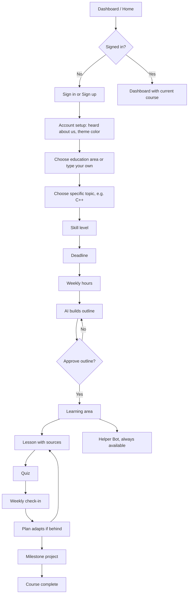

# All Learn: Evaluation and Android Build Specification

> **Instructions for the AI coding assistant:** This document is the single source of truth for building All Learn, an Android-only mobile app. Read it fully before writing code. Build in the order given in Section 11. Where a choice is marked "default", use it unless the developer says otherwise. Where a choice is listed under Open Decisions (Section 13), ask the developer before building that part. Do not add features that are listed as out of scope (Section 14).

---

## 1. Project Overview

**Name:** All Learn
**Platform:** Android only (native mobile app). No iOS, no web version in this phase.
**One-line pitch:** All Learn builds a learning plan around your deadline and free hours, grounds every lesson in trusted sources, and adapts weekly to keep you on track until you finish.

**Problem:** Existing learning platforms use fixed, pre-made courses. They do not adapt to a learner's deadline (for example "master this in 2 to 3 months") or to the hours per week the learner can actually give. Learners also cannot reshape their outline, so they get a one-size-fits-all curriculum.

**Solution:** An AI curriculum architect. The user picks a field and topic, a skill level, a deadline and weekly hours. The AI generates a tailored outline. The user approves it or asks for a new one. After approval, the app delivers a step-by-step course with lessons, quizzes, weekly check-ins, a plan that re-adjusts when the user falls behind, and a 24/7 Helper Bot.

**Target users:** Students, professionals and lifelong learners of any background and level. Launch market: Ethiopia (with attention to low-end phones and slow or expensive data), with later international expansion.

---

## 2. Idea Evaluation

All percentages are judgment-based estimates, not measured data.

### 2.1 Scorecard

| Criteria | Original proposal | With fixes in this spec | Notes |
|---|---|---|---|
| Problem clarity | 70% | 80% | Deadline plus weekly-hours is a real, easy-to-explain pain point. |
| Market size | 90% | 90% | Very large audience of self-learners and students. |
| Technical feasibility | 80% | 85% | Outline generation, regeneration and a chatbot are doable with current LLM APIs. |
| Originality | 35% | 55% | Similar AI roadmap tools exist. Originality now comes from deadline-fit plus accountability plus local context. |
| Content quality and accuracy | 45% | 70% | Source-linked lessons and a verification pass reduce errors. |
| Defensibility (moat) | 30% | 50% | Local niche, progress data and accountability loop are harder to copy than a prompt. |
| User retention | 50% | 75% | Quizzes, streaks, weekly check-ins and catch-up mode. |
| Monetization clarity | 25% | 65% | Free tier plus paid tier defined in Section 4. |
| Proposal completeness | 60% | 90% | This document. |
| **Overall** | **about 55%** | **about 75 to 80%** | |

### 2.2 Biggest weaknesses and how this spec fixes them

1. **"Complete automation of high-quality education" is risky.** If a lesson is wrong, trust is lost.
   Fix: automate the structure and delivery, verify the substance. Lessons are grounded in real sources, passed through a second AI check, and users can report mistakes. Launch only in fields where answers can be checked (programming first).
2. **"No human-curated limits" hurts trust.**
   Fix: position the product as "AI-generated, source-backed learning paths." Show source links and a "last verified" date. Add "Expert Reviewed" badges later.
3. **It is a feature, not a product.** A user can already ask a general chatbot for a 12-week plan.
   Fix: build what a chatbot does not give: a living plan that re-adjusts weekly, quizzes, progress history, reminders and streaks, and local-context support.
4. **A plan is not learning.** Personalization is easy. Consistency over 2 to 3 months is hard.
   Fix: weekly check-ins, short quizzes after each lesson, spaced repetition, streaks, reminders, milestone projects and a catch-up mode.

### 2.3 Strengths to protect

- Clear core promise: the plan fits the user's time.
- Simple, understandable onboarding.
- User control: approve or regenerate the outline.
- Always-available Helper Bot.

---

## 3. Product Positioning

Use this wording in the app store listing, onboarding text and marketing:

> "All Learn builds a learning plan around your deadline and free hours, grounds every lesson in trusted sources, and adapts weekly to keep you on track until you finish."

Do not use the phrase "complete automation of education" anywhere in the app.

---

## 4. Scope

### 4.1 MVP (build now)

- Account: sign up, sign in, forgot password.
- Account setup: "How did you hear about us", theme color choice.
- Onboarding: education area, specific topic, skill level, deadline, weekly hours.
- AI outline generation, preview, approve, regenerate.
- Course delivery: weekly plan, lessons with source links, quizzes.
- Weekly check-in and automatic plan adjustment (catch-up mode).
- Helper Bot (text chat, lesson-aware).
- Progress dashboard with streak.
- Local reminder notifications.
- Report-a-mistake button on every lesson.
- Launch fields: Programming first (checkable answers). Other fields listed in the UI are allowed, but show a short notice such as "AI-generated. Verify important information" on non-programming fields.

### 4.2 Free versus paid (default, can change)

| Feature | Free | Paid |
|---|---|---|
| Active courses | 1 | Unlimited |
| Outline regenerations per course | 3 | Unlimited |
| Helper Bot messages per day | 20 | Much higher limit |
| Certificates of completion | No | Yes |
| Offline lesson downloads | No | Yes |

Payment integration is Phase 2 (see Section 14). The MVP should include the limits and the paywall screens but can ship with limits enforced and payment stubbed.

### 4.3 Later phases (not in MVP)

- Amharic and Afaan Oromoo interface and course language.
- Ethiopian Exit Exam preparation track.
- Mobile payments (Telebirr, CBE Birr).
- Telegram or SMS reminders.
- Expert-reviewed course badges.
- Offline mode.

---

## 5. Platform and Tech Stack (defaults)

The developer is a web and software developer. The stack below is a recommended default. Change it only if the developer asks.

| Layer | Default choice | Reason |
|---|---|---|
| Language | Kotlin | Standard for native Android. |
| UI | Jetpack Compose with Material 3 | Modern, less code, supports theming. |
| Architecture | MVVM, single-activity, Navigation Compose | Clear and testable. |
| Min SDK | 24 (Android 7.0) | Covers many low-end phones. Target the latest stable SDK. |
| Local storage | Room (database) and DataStore (settings) | Offline cache of the current course and progress. |
| Networking | Retrofit or Ktor client with Kotlin serialization | Standard. |
| Backend | Firebase: Authentication, Firestore, Cloud Functions | Fast to build, free tier is enough for MVP. |
| AI | An LLM API called only from Cloud Functions | The API key must never be inside the app. |
| Notifications | Local scheduled notifications (WorkManager) for reminders; Firebase Cloud Messaging optional | Works with poor connectivity. |
| Crash and analytics | Firebase Crashlytics and Analytics | Needed to fix problems after launch. |

**Security rules (mandatory):**
- Never place any API key or secret in the Android app.
- Validate all user input on the client and again in Cloud Functions.
- Firestore security rules: a user can read and write only their own documents.
- Rate-limit AI calls per user on the server.

---

## 6. User Flow

### 6.1 Diagram



### 6.2 Flow rules

- A returning signed-in user goes straight to the dashboard and current course. They do not repeat setup.
- Account setup (heard about us, theme) is shown once, right after the first sign-up. Theme can be changed later in Settings.
- The course-setup questions (area, topic, level, deadline, hours) are shown each time the user starts a new course.
- The back button on every setup screen returns to the previous answer without losing entered data.

---

## 7. Screen Specifications

### 7.1 Dashboard (home)

- Signed-out: short product pitch, buttons "Sign in" and "Create account".
- Signed-in: current course card (title, progress %, this week's goal, next lesson button), streak counter, "Start a new course" button, Helper Bot button, bottom navigation: Home, Courses, Progress, Settings.

### 7.2 Sign up

- Fields: Email, Password, Confirm password.
- Password rules: minimum 8 characters, at least one letter and one number (default). Show a live checklist of rules and a show/hide password toggle.
- Errors: invalid email, email already in use, password too weak, passwords do not match, no connection.
- Button disabled until fields are valid.

### 7.3 Sign in

- Fields: Email, Password.
- Link: "Forgot password?" opens the Forgot Password panel.
- Errors: wrong email or password (do not reveal which one), no connection, too many attempts.

### 7.4 Forgot password panel

- Field: Email. Button "Send reset link".
- Always show the same confirmation message ("If this email has an account, a reset link was sent") so account existence is not revealed.

### 7.5 Account setup (shown once after sign-up)

- Question: "How did you hear about us?" Options: Friend or family, Social media (Facebook, TikTok, Instagram, Telegram, YouTube), Search, School or university, Other (text field). Skippable.
- Theme: choose an accent color from 5 to 6 options, with light and dark mode toggle. Preview updates live.

### 7.6 Choose education area

- Grid of area cards. Default list: Programming, Psychology, Food and Culinary, Business, Languages, Mathematics, Design, Health and Fitness.
- A search bar and an "Other" card. "Other" opens a text field so the user can type any topic. Minimum 2 characters, maximum 60.
- Safety: reject clearly harmful or illegal topics with a friendly message.

### 7.7 Choose specific topic

- Shows sub-areas for the chosen area. Example for Programming: C++, Python, Java, JavaScript, Kotlin, Web development, Data structures and algorithms.
- Includes an "Other" option with a text field.
- For typed custom areas, the AI proposes 4 to 6 sub-topics and the user picks one or types their own.

### 7.8 Skill level

- Options: Beginner, Intermediate, Advanced. Optional short note: "What do you already know?" (max 200 characters).

### 7.9 Deadline

- Quick options: 1 month, 2 months, 3 months, 6 months, Custom.
- Custom: number of weeks or a date picker. Allowed range: 2 weeks to 12 months.
- Show the computed end date.

### 7.10 Weekly hours

- Quick options: 3, 5, 7, 10, 15 hours per week, Custom (1 to 40).
- Optional: preferred study days (checkboxes) and reminder time.
- Show a summary line: "About X total hours until [date]". If total hours look too small for the topic and level, show a gentle warning and let the user continue or change inputs.

### 7.11 Outline preview

- Loading state with progress text ("Building your plan...") and a cancel option. Timeout after 60 seconds with a retry button.
- Shows: course title, total weeks, hours per week, phases, and a week-by-week list (week title and main lessons).
- Buttons: **Approve and start** and **Regenerate**.
- Regenerate opens an optional text field: "What should change?" (for example "less theory, more projects"). Respect the free-tier regeneration limit.

### 7.12 Learning area

- Week view: current week goal, list of lessons with status (not started, in progress, done), quiz and milestone markers.
- Lesson screen: title, estimated minutes, explanation text, "Sources" section with tappable links, "Mark as done", "Report a mistake", and a Helper Bot button that opens the bot with this lesson as context.
- Quiz screen: 3 to 8 questions per lesson (multiple choice and short answer where possible), instant feedback with explanation, score saved to progress.
- Weekly check-in (appears at the end of each week or on the first app open of a new week): "Did you finish this week?", with answer options and a short reflection. Triggers plan adjustment.
- Milestone project screen at the end of each phase: project brief, checklist, optional submission note.
- Completion screen: summary, stats, and certificate (paid).

### 7.13 Helper Bot

- Chat screen with message history per course.
- Context sent with each message: course topic, level, current lesson, short summary of progress.
- Answers questions about the current lesson and relevant broader topics. If a question is unrelated to learning, politely redirect.
- Show a short disclaimer on first use. Show remaining free messages for the day.

### 7.14 Progress

- Streak, hours studied this week versus planned, quiz average, lessons completed, timeline of phases.

### 7.15 Settings

- Theme and dark mode, reminder time and days, notification toggle, language (English now; others later), change password, delete account and data, sign out, help and feedback.

---

## 8. AI Behavior Specification

All AI calls run in Cloud Functions. The app only sends structured inputs and receives structured JSON.

### 8.1 Outline generation

**Input:**

```json
{
  "area": "Programming",
  "topic": "C++",
  "level": "beginner",
  "level_note": "I know basic computer use",
  "deadline_weeks": 12,
  "hours_per_week": 7,
  "preferences": "more projects",
  "language": "en"
}
```

**Required output (JSON only):**

```json
{
  "title": "C++ for Beginners in 12 Weeks",
  "total_weeks": 12,
  "hours_per_week": 7,
  "phases": [
    {
      "phase": 1,
      "title": "Foundations",
      "weeks": [1, 2, 3],
      "goal": "Write and run basic programs",
      "milestone_project": "Simple calculator"
    }
  ],
  "weeks": [
    {
      "week": 1,
      "title": "Setup and first program",
      "planned_minutes": 420,
      "lessons": [
        {
          "id": "w1-l1",
          "title": "Installing a compiler",
          "minutes": 45,
          "sources": [
            { "title": "Official docs page", "url": "https://...", "type": "docs" }
          ]
        }
      ],
      "has_quiz": true
    }
  ]
}
```

**Rules for the outline:**
- Total planned minutes per week must be between 85% and 100% of `hours_per_week × 60`.
- Number of weeks must equal the deadline (or be shorter if the topic is small; never longer).
- Lessons must progress from simple to complex and match the stated level.
- Each phase ends with a milestone project.
- Reserve the final week for review and the final project.
- Every lesson must include at least one source link. Prefer official documentation, open courseware and reputable free educational content.
- Output must be valid JSON matching the schema. If it does not parse, retry up to 2 times, then show an error with a retry button.

### 8.2 Lesson generation

- Generate the lesson text on first open (or in advance for the next lesson) and cache it in Firestore.
- The lesson must be based on the listed sources: explain, summarize and structure; do not invent facts or fake links.
- Include: learning goals (2 to 4), explanation with examples, a short summary, and 3 to 8 quiz questions with correct answers and explanations.
- **Verification pass:** a second AI call checks the lesson text and quiz answers against the sources and flags contradictions or unsupported claims. If flagged, regenerate once. If still flagged, mark the lesson "needs review" and show a notice.
- Store "last verified" date on each lesson.

### 8.3 Weekly check-in and plan adjustment

- Completion rate for the week = completed planned minutes divided by planned minutes.
- If the rate is 70% or higher: continue as planned, carry over a small remainder.
- If the rate is below 70%: offer two choices:
  1. **Compress:** keep the deadline and merge or trim lower-priority lessons in the remaining weeks (never remove milestone projects).
  2. **Extend:** keep all content and move the deadline later by the number of missed weeks.
- If the user changes weekly hours, regenerate only the remaining weeks and keep completed lessons unchanged.
- Show the user a short summary of what changed.

### 8.4 Helper Bot

- System rules: be accurate, concise and encouraging; say "I'm not sure" instead of guessing; suggest checking the lesson sources for important facts; do not give medical, legal or financial advice beyond general educational information; refuse harmful requests.
- Keep conversation history per course, limited to the last N messages (default 20) to control cost.

### 8.5 Cost and safety controls

- Per-user daily limits on outline generations, lesson generations and bot messages.
- Cache every generated lesson so it is generated once and reused.
- Log AI errors without logging personal data.

---

## 9. Data Model (Firestore, default)

```
users/{userId}
  email, createdAt, heardAboutUs, themeColor, darkMode, plan ("free" | "paid"),
  reminderTime, studyDays[], streakCount, lastStudyDate

users/{userId}/courses/{courseId}
  area, topic, level, levelNote, deadlineDate, hoursPerWeek,
  status ("outline_pending" | "active" | "completed" | "paused"),
  outline (JSON as in 8.1), regenerationsUsed, createdAt, updatedAt

users/{userId}/courses/{courseId}/lessons/{lessonId}
  weekNumber, title, minutes, sources[], content, quiz[],
  status ("not_started" | "in_progress" | "done"),
  quizScore, lastVerified, needsReview, completedAt

users/{userId}/courses/{courseId}/checkins/{checkinId}
  weekNumber, completionRate, choice ("continue" | "compress" | "extend"), note, createdAt

users/{userId}/courses/{courseId}/chat/{messageId}
  role ("user" | "assistant"), text, createdAt

reports/{reportId}
  userId, courseId, lessonId, message, createdAt, status
```

Cache the active course and current week's lessons in Room so the app opens fast and works for already-loaded lessons without a connection.

---

## 10. Non-Functional Requirements

- **Performance:** cold start under 3 seconds on a low-end device (2 GB RAM). Screens show loading skeletons, not blank pages.
- **Low-data design:** compress and cache lessons, avoid images and video inside the app (link to external sources), and keep API payloads small.
- **Offline behavior:** previously opened lessons are readable offline. Actions that need the server (outline, new lessons, bot) show a clear "No connection" message and a retry button.
- **Accessibility:** minimum touch target 48dp, readable font sizes, sufficient color contrast in all themes, content descriptions on icons.
- **Localization-ready:** put all user-facing strings in `strings.xml` (no hard-coded text) so Amharic and Afaan Oromoo can be added later.
- **Privacy:** collect only what is needed. Provide in-app account and data deletion. Include a privacy policy link on the sign-up screen and in Settings.
- **Reliability:** handle API timeouts, malformed AI output and expired sessions gracefully.
- **Testing:** unit tests for the outline-validation logic, time-math and plan-adjustment logic; UI tests for sign-up, onboarding and approve/regenerate flows.

---

## 11. Build Order for the AI Coding Assistant

Complete each milestone and confirm it runs before starting the next.

1. **Project setup:** Android project with Compose, Material 3 theme system (accent color and dark mode), navigation graph, Firebase connection, `strings.xml`.
2. **Authentication:** sign up, sign in, forgot password, validation, session persistence, sign out.
3. **Account setup and theme:** "heard about us" screen, theme picker, saved to user profile.
4. **Onboarding questions:** area, topic (with "Other" typing), level, deadline, weekly hours, with back-navigation that keeps answers.
5. **Outline generation:** Cloud Function plus JSON validation, loading and error states, outline preview, approve and regenerate (with free-tier limit).
6. **Course home and lessons:** week view, lesson generation with sources, caching, mark as done, report a mistake.
7. **Quizzes:** quiz screen, scoring, saving results.
8. **Weekly check-in and plan adjustment:** completion-rate logic, compress or extend, remaining-weeks regeneration.
9. **Helper Bot:** chat UI, context passing, daily limit.
10. **Progress, streak and reminders:** dashboard stats, WorkManager notifications.
11. **Free versus paid limits and paywall screens** (payment stubbed).
12. **Polish and release:** error states, empty states, accessibility pass, performance pass, Crashlytics, app icon and splash, Play Store assets, privacy policy.

---

## 12. Acceptance Criteria (MVP)

- A new user can create an account (8+ character password enforced), complete setup, and see an approved outline in under 5 minutes on a normal connection.
- Typing a custom area that is not in the list works end to end and still produces an outline.
- The generated outline respects the chosen deadline and weekly hours (weekly minutes within 85 to 100% of the target).
- Rejecting an outline and regenerating produces a different outline and increments the regeneration counter.
- Every lesson shows at least one working source link and a "Report a mistake" button.
- Completing a lesson and its quiz updates progress, streak and the weekly completion rate.
- Missing more than 30% of a week triggers the compress or extend choice, and the resulting plan is valid.
- The Helper Bot answers using the current lesson as context and respects the daily limit.
- No API keys exist anywhere in the APK or the repository.
- The app runs on Android 7.0 and above without crashes during the flows above.

---

## 13. Open Decisions (ask the developer before building these parts)

1. **Login identifier:** the original idea asked for a username at sign-in and an email at sign-up. Default in this spec is email plus password for both. Add a display name (optional) if a username is wanted.
2. **AI provider and model** for outline, lessons and bot, and the monthly budget cap.
3. **Launch fields:** programming only, or several fields from day one.
4. **Final free versus paid limits and pricing.**
5. **App language at launch:** English only (default) or English plus Amharic.
6. **Final app name, logo and brand colors** (the theme system should work with any palette).

---

## 14. Out of Scope for This Phase

- iOS and web apps.
- Video hosting or uploading own video content.
- Real-time live classes, social features, leaderboards and chat between learners.
- Payment gateway integration (stubbed only).
- Human tutors and marketplace features.
- Admin web dashboard (use the Firebase console for now).
